# NIGHT FROGS · NFROG

The crew that works the 3 AM shift on the NIGHTSHIFT ship while the founders sleep. Tired, caffeinated, a little dangerous. Always shipping.

**Up to 500 original, fully onchain ERC-721s. IDs 1–77 are Genesis. #1 is the unique Zero-Sleep Captain.** Nothing is pre-minted, including #1. Every mint costs IMD, initially **2 IMD**, with an immutable **50% burn / 50% treasury** split. There is no new ERC-20, pool, proxy, pause switch, or free owner mint. The owner's reveal request ends the sale at whatever has been minted by then; the supply can never exceed 500 and never grows after the request.

## The crew

These are actual SVGs decoded from `NightFrogs.tokenURI` after a **local mock** fulfillment with demonstration word `20261016`. They are illustrative, not a prediction of production VRF results. The 16 previews collectively include all 48 layer variants. The 300 px PNG thumbnails link to full-detail SVGs; the contract returns the original SVG and JSON entirely onchain.

| #1 | #2 | #77 | #78 |
| :---: | :---: | :---: | :---: |
| [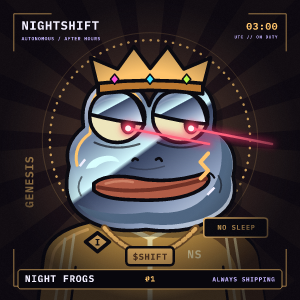](docs/previews/frog-001.svg) | [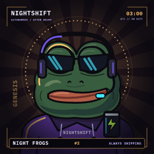](docs/previews/frog-002.svg) | [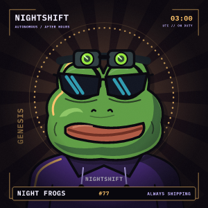](docs/previews/frog-077.svg) | [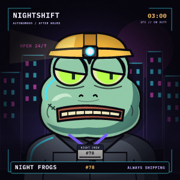](docs/previews/frog-078.svg) |

| #79 | #80 | #81 | #82 |
| :---: | :---: | :---: | :---: |
| [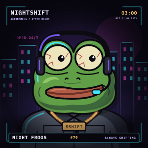](docs/previews/frog-079.svg) | [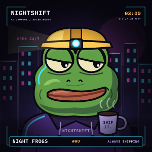](docs/previews/frog-080.svg) | [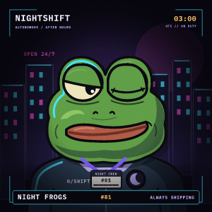](docs/previews/frog-081.svg) | [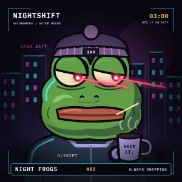](docs/previews/frog-082.svg) |

| #83 | #84 | #112 | #113 |
| :---: | :---: | :---: | :---: |
| [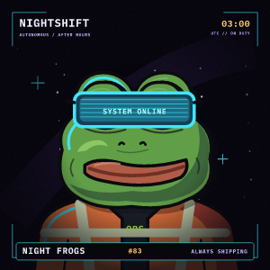](docs/previews/frog-083.svg) | [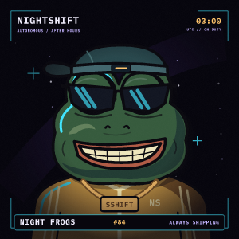](docs/previews/frog-084.svg) | [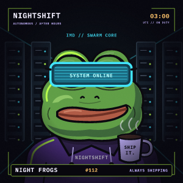](docs/previews/frog-112.svg) | [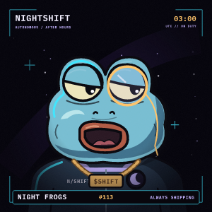](docs/previews/frog-113.svg) |

| #131 | #187 | #224 | #500 |
| :---: | :---: | :---: | :---: |
| [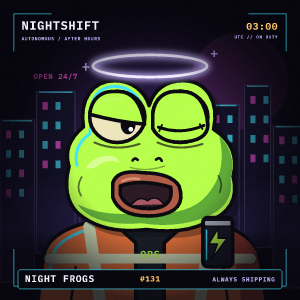](docs/previews/frog-131.svg) | [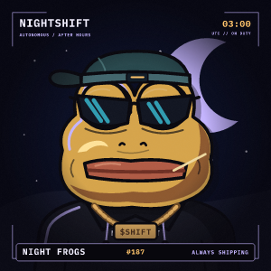](docs/previews/frog-187.svg) | [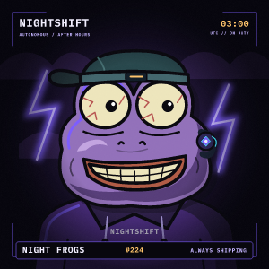](docs/previews/frog-224.svg) | [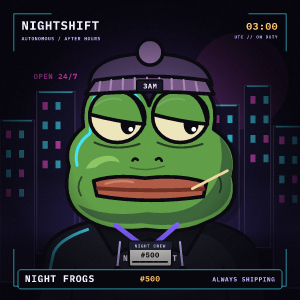](docs/previews/frog-500.svg) |

[200 px contact sheet](docs/previews/contact-sheet.png) · [Unrevealed moon](docs/previews/moon.svg) · [Preview metadata and checksums](docs/previews/index.json)

## Minting and ownership

- Call `IMD.approve(nightFrogsAddress, quantity * price())`, then `mint(quantity, maxTotalCost)` with the cost you were quoted. The mint reverts with `CostAboveLimit` if `price() * quantity` is above the ceiling, so a price change mined ahead of your transaction can never charge you more than you agreed to, even with an unlimited IMD approval. The plain `mint(quantity)` charges whatever the price is when it executes; use it only with an approval of exactly the current cost. IMD address: `0xD34a99Bc0f67aE1bbd63C660e6d0b0dd03E263B7`.
- IDs are sequential, 1 through at most 500. One transaction can mint 1–10; each address may mint **10 over its lifetime**. Transfers do not replenish that allowance. Wallet limits do not prevent one person using multiple wallets.
- Minting closes for good, with `MintClosed`, the moment the owner's first reveal request is accepted by the coordinator (see below). IDs that were not minted by then never exist.
- The contract collects IMD, verifies the payer's debit and its own receipt, then sends equal halves to `0x000000000000000000000000000000000000dEaD` and the treasury. It verifies both recipient balances and retains none of the mint proceeds. All steps, ERC-721 receiver callbacks, counters and events revert together on failure.
- `Burned(payer, amount, cumulativeBurned)` records each burn transfer; `totalBurned()` counts only burns from this collection. “Burn” means an irrecoverable transfer to the specified sink, not a call that decreases the IMD token's `totalSupply`. At the initial price, a sellout pays 1,000 IMD: 500 to the sink and 500 to the treasury.
- Prices are smallest-unit IMD amounts. IMD has 18 decimals, checked on mint. `setPrice` accepts positive **even** amounts up to `type(uint256).max / 500`, so a single mint always splits exactly. The smallest accepted price is two smallest units. The owner can change prices while the sale remains open.
- `setTreasury` changes future proceeds only. Zero, the burn sink and the collection itself are rejected. The initial treasury is the supplied owner; the treasury may also be a minter.
- Standard ERC-721 approvals and transfers have no fees or holding limits. Transfers do not change `totalBurned`. ERC-2981 reports **5% to the current owner**, including after a two-step ownership transfer. Royalty payment depends on marketplace support; it is not a transfer tax. Treasury changes separately from ownership.
- There is no NFT burn function, reserve, owner airdrop, withdrawal of mint proceeds, upgrade, base-URI setter, or pause function. Ownership renunciation is disabled to retain an accountable reveal operator and royalty recipient.

## Reveal and randomness

The owner configures a Chainlink VRF v2.5 subscription and key hash after deployment, then calls `reveal()` **once, at a time of their choosing, after at least one token is minted**. The request itself closes the sale: `SaleClosed(finalSupply)` is emitted, `mint` reverts from then on, and the supply is frozen at that number. That is what keeps the draw fair without requiring a sellout: nobody can mint, selectively or otherwise, once a random word has been requested, and every existing ID was paid for before the seed existed. Calling `reveal()` with nothing minted reverts `NothingMinted`. There is no refund path; proceeds are distributed at mint. Whether to wait for 500 or close earlier is the owner's operational decision; the contract never raises `MAX_SUPPLY`.

The request asks for one word, **3 confirmations**, **120,000 callback gas**, and **LINK subscription payment** (`nativePayment = false`). Its ABI and extra-arguments tag match the [official VRF v2.5 client](https://github.com/smartcontractkit/chainlink-evm/blob/develop/contracts/src/v0.8/vrf/libraries/VRFV2PlusClient.sol). The supplied coordinator matches [Chainlink's Ethereum network table](https://docs.chain.link/vrf/v2-5/supported-networks#ethereum-mainnet).

Only the immutable coordinator may deliver the latest recorded request, exactly once. A zero random word is valid. Fulfillment stores the word and emits `BatchMetadataUpdate(1, totalSupply)`; it performs no art rendering or external calls. Once fulfilled, the reveal is final: `reveal()` and `configureVRF` revert `RevealAlreadyRequested` forever, and no further word is ever accepted. There is no owner-chosen seed, reroll of a delivered word, fallback entropy, or coordinator migration authority. A request transaction that reverts leaves the state unchanged and can be tried again.

**Stale requests.** The live coordinator does not validate the key hash, and a request can also be dropped when the subscription runs dry before fulfillment or the callback fails; Chainlink never retries. So an accepted request that stays unfulfilled for `REVEAL_RETRY_DELAY` (**3 days**, a named constant) becomes *stale*: `revealRequestStale()` turns true, the owner may call `configureVRF` again to correct the subscription or gas lane, and `reveal()` again to make a replacement request. The replacement emits `RevealRequestAbandoned(oldId)` and `RevealRequested(newId)`; from then on only the new request id can fulfill. A late fulfillment of a stale request that arrives *before* it is replaced still reveals normally. The sale stays closed throughout. The 3-day window is well beyond the coordinator's own request timeout, so a replacement can only ever be made for a request Chainlink has already given up on; it does not let the owner reroll a word that has been or is about to be delivered. See the [VRF security considerations](https://docs.chain.link/vrf/v2-5/security).

For each random layer, the renderer uses:

```text
keccak256(abi.encode("NIGHT_FROGS_V1", randomWord, tokenId, uint8(layer))) % 100
```

Cumulative rarity weights select that layer's index. Genesis IDs always use the golden sunburst. #1 has a fixed set: golden background, gold tracksuit, chrome skin, corner smirk, laser eyes, gem crown and SHIFT chain, plus an exclusive gold command scar, captain insignia and NO SLEEP plate. Its `Signature` attribute is `Zero-Sleep Captain / 1 of 1`; every other ID has `Crew Issue`. Other combinations may repeat. Weights are probabilities, not guaranteed edition counts.

## Original art and onchain storage

All 48 variants are original vector drawings made for this project. They use one 1000×1000 coordinate system and shared head, eye and shoulder anchors. The draw order is background → body → skin → mouth → eyes → headwear → accessory → captain details → grain, vignette and frame. Muted green, rust lips, black contours, heavy lids, side-looking pupils and glossy eye highlights define the character. Left-edge neon light changes with the scene. The SVG uses native gradients, `feTurbulence`, local shape references and generic monospace text; it fetches no fonts, images or scripts.

`FrogArt1` and `FrogArt2` each create one immutable **SSTORE2** data child in their constructor. Its runtime is `STOP || packed records`; every artwork layer, common definition, placeholder, captain detail and trait name is stored there. The two payloads contain 100 records, about 40 KB in total. `ArtStore.read` uses bounded `EXTCODECOPY` to retrieve a record. Neither the applications nor the data children can change these records.

`FrogRenderer` has immutable references to both art banks. It assembles the selected SVG and base64 JSON with all seven visual attributes, edition and signature. `NightFrogs.tokenURI` rejects unminted IDs and uses the stored VRF result. The renderer also exposes `traits`, `traitName`, `traitWeight`, `traitSVG` and `imageSVG` for inspection; calling its preview methods does not mint an NFT.

The editable vector source and packer is [`tools/build_art.py`](tools/build_art.py). Readable layer fragments and the catalog are in [`art/`](art/catalog.json). Fragments reference shared definitions and are not standalone pictures. Regenerate with `python3 tools/build_art.py`, check with `python3 tools/check_art.py`, and rebuild/test. Generated bank boundaries and the renderer's record layout must agree; deployment and rendering tests check the current layout.

### Rarity weights

| Layer | Variants and relative weights |
| --- | --- |
| Background | Neon City 30; Ultraviolet Storm 20; Moonlit Sky 20; Deep Starfield 20; Server Corridor 10; Genesis Sunburst: forced for IDs 1–77 only |
| Body | Black Hoodie 30; Purple Hoodie 23; Hi-vis Safety Vest 18; Grey Work Jacket 15; NIGHTSHIFT Jumpsuit 11; Gold Tracksuit 3 |
| Skin | Classic Green 35; Dark Green 20; Acid Neon 15; Mint Zombie 5; Ice Blue 10; Purple Alien 10; Gold 4; Chrome 1 |
| Mouth | Corner Smirk 28; Toothpick 20; Big Grin 15; 3 AM Yawn 12; Knowing Smile 18; Gritted Teeth 7 |
| Eyes | Heavy Lids 38; Laser Eyes 7; Neon Shades 16; Cyan VR Visor 8; Wired 12; Deadpan Wink 10; Acid Glow 7; Monocle 2 |
| Headwear | Headlamp Hard Hat 20; Night Beanie 20; Dispatcher Headset 17; Gold Crown 3; Backwards Cap 17; Night Vision 8; Moonlight Halo 1; None 14 |
| Accessory | SHIFT Chain 15; Crew ID Badge 22; Shipping Coffee 27; Overtime Energy 14; IMD Swarm Earpiece 8; None 14 |

Each ordinary draw totals 100. Genesis background is a separate, deterministic eligibility rule. Captain #1 bypasses all draws.

## Deployment handoff

This repository is the deliverable for the IdentityMD launch service. **No production transaction has been broadcast here.** The service creates the manifest, attests the accepted source, deploys through its factory and returns confirmed contract addresses. No private key, funded wallet, subscription ID, fabricated deployment address, or `launch.json` is included.

**Chain:** Ethereum, chain ID 1. **Owner:** `0x6C4c78f2C3bDf4C4318Fe305FB1C8BC1694d19b5`, supplied by the assignment. Deploy these **four applications in order**, from their compiled creation bytecode:

| Application | Constructor arguments, in order |
| --- | --- |
| `FrogArt1` | none |
| `FrogArt2` | none |
| `FrogRenderer` | deployed `FrogArt1` address, deployed `FrogArt2` address |
| `NightFrogs` | supplied owner (`$owner`), `0xD7f86b4b8Cae7D942340FF628F82735b7a20893a`, deployed `FrogRenderer` address |

`FrogData` is an internal SSTORE2 child, **not** a fifth application to put in the manifest. The art banks and renderer have no owner or admin. Every application uses a nonpayable constructor with static arguments, no linked libraries, and no call to an already deployed contract during construction. The collection's owner is its explicit argument, never the factory or `tx.origin`. All immutable artwork is installed in constructors; no uploader or art initialization step exists.

`foundry.toml` pins **Solidity 0.8.26**, Cancun EVM, optimizer with 200 runs, via-IR, and `bytecode_hash = "none"`. Runtime and initcode are below EIP-170 / EIP-3860 limits. The local factory rehearsal measures about **13.3 million gas for all four applications**, including its test overhead; the launch service must simulate its complete transaction and enforce its own gas limit. Data children are included in that deployment cost. No unsafe opcodes occur in application runtimes.

Read-only Ethereum RPC checks during development found IMD `symbol() == "IMD"`, `decimals() == 18`, and nonempty code at the supplied coordinator. These are observations, not a fork test or production attestation. The deployer must recheck the fixed dependencies and compiled bytes before launch. Contracts remain immutable afterward.

### After launch

1. Verify the four application addresses, ownership, initial treasury, zero minted supply, data-child code, and representative `FrogRenderer` output against this source. Publish the confirmed address set; do not reuse local test addresses.
2. The owner creates or selects a **VRF v2.5 Ethereum subscription** in the [Chainlink subscription manager](https://vrf.chain.link/), funds it with LINK, and registers the deployed `NightFrogs` address as a consumer. These are the owner's subscription and funds.
3. The owner calls `configureVRF(subscriptionId, keyHash)`, using that actual subscription ID and a current Ethereum gas lane from [Chainlink's network parameters](https://docs.chain.link/vrf/v2-5/supported-networks#ethereum-mainnet). Both values start unset and reject zero. Configuration emits `VRFConfigured`, can be corrected before requesting, and locks while a request is pending. Double-check the key hash against the published table before requesting: the coordinator accepts any value and silently never fulfills an unknown one. `reveal()` reverts clearly while unconfigured.
4. If desired, the owner calls `setTreasury(actualRecipient)` and/or `setPrice(evenPositiveSmallestUnits)`. Neither operation changes the split. Announce price changes ahead of time: buyers using `mint(quantity)` with an open approval are charged the price at execution, while `mint(quantity, maxTotalCost)` protects them. Moving ownership uses `transferOwnership(newOwner)` followed by `acceptOwnership()` from the proposed owner; review the treasury independently.
5. When the sale should end, whether at 500 or earlier, the owner calls `reveal()`, records `revealRequestId`, and monitors fulfillment. This permanently closes minting. Keep the subscription funded and the consumer registered until fulfillment. Check `revealed()`, the `Revealed` event and updated token metadata. Transfers remain available throughout.
6. If `revealed()` is still false 3 days after the request, `revealRequestStale()` is true. Diagnose the cause in the subscription manager (wrong gas lane, LINK balance, failed callback), fix it with `configureVRF` and subscription funding if needed, and call `reveal()` again. Repeat until the `Revealed` event appears.

The owner controls price, treasury, VRF setup, ownership handover and when to request reveal, which ends the sale. Holders depend on the owner making that request and on Chainlink delivering it. Neither the seed, cap, mint allowance, royalty rate, burn ratio, renderer nor art can be changed. An independent contributor's adversarial review and the launch service's final verification remain release responsibilities; the local tests are not an independent audit.

### Economic trust assumptions

These follow from the brief as written and are recorded so the trust model is explicit, not as defects:

- **Price floor.** `setPrice` accepts any even amount down to 2 smallest units. The owner could therefore lower the price and buy the remaining supply for almost nothing through many wallets. "The owner cannot mint for free" holds in the sense that every mint pays the current price with half burned; it does not stop the owner from making that price negligible. Price changes are public events.
- **Owner as treasury.** The treasury defaults to the owner and receives half of every payment in the same transaction. At the default price the owner's own mints cost a net 1 IMD each, with the other 1 IMD burned.
- **Per-address cap.** `MAX_PER_WALLET` is keyed by `msg.sender`. It limits addresses, not people; one actor with 50 fresh addresses can buy all 500.
- **Sequential IDs.** The first successful mint in a block receives the lowest IDs. The fixed 1-of-1 Captain (#1) and the 77 Genesis backgrounds go to whoever mints first, which block builders can influence by ordering. Every other trait is drawn from the VRF word after the sale closes.

## Reproduce the checks offline

All Solidity dependencies are vendored as ordinary files: OpenZeppelin Contracts **v5.0.2** and forge-std **v1.9.7**, with their licenses. There are no submodules, package installation steps, environment-reading tests, filesystem-permitted tests, RPC-dependent tests or FFI. Foundry and the pinned compiler are the only build prerequisites.

```sh
forge build
FOUNDRY_FUZZ_SEED=0x0050b8a1b49c4ae4c51c35cba455d17f5ce7f08ea544adaf6f2f4175d2365a14 forge test
forge fmt --check
python3 tools/check_art.py
```

The suite exercises paid mints, lifetime wallet and absolute supply boundaries, owner payments, exact balances and burn logs, changing recipients/prices, the cost ceiling against a price raise mined first, no-return/false-return/taxed/reverting IMD, receiver rejection, payment and receiver reentrancy, transfers/approvals, royalty ownership handover, configuration failures, failed requests, request authentication, zero-word and duplicate callbacks, callback gas, reveal before sellout with minting closed afterwards, stale-request replacement exactly at the delay boundary and never after fulfillment, late fulfillment of a stale request, all trait ranges, decoded metadata and SSTORE2/deployment limits. Stateful invariants reconcile burns, every treasury, minted supply and ownership across randomized action sequences that include the owner closing the sale at an arbitrary point. The Chainlink mock tests local consumer behavior; it does not prove production VRF delivery.

Rebuild all documentation previews from contract output, with no network:

```sh
python3 tools/render_previews.py
```

This runs the local integration export test, decodes and validates its JSON/SVG, and rasterizes with **Node.js** and the vendored **resvg WASM 2.6.2**. The optional rasterizer and IBM Plex Mono font are ordinary files under `tools/vendor/` with their licenses. Neither is a contract dependency. PNGs use IBM Plex Mono; marketplace SVG viewers use their own generic monospace font and may render filters differently. Solidity tests do not write any files.

To keep the source bundle within the 8 MiB upload limit, individual PNG previews are 300×300 and the contact sheet is 800×800 (200 px per token). Full-detail SVGs and their metadata remain included. The contact-sheet SVG references its sibling PNGs; only the PNG contact sheet is self-contained. The exporter embeds images in memory during rasterization instead of storing redundant base64 copies in the source bundle.

See [the local review notes](docs/REVIEW.md) and [dependency provenance](DEPENDENCIES.md).
